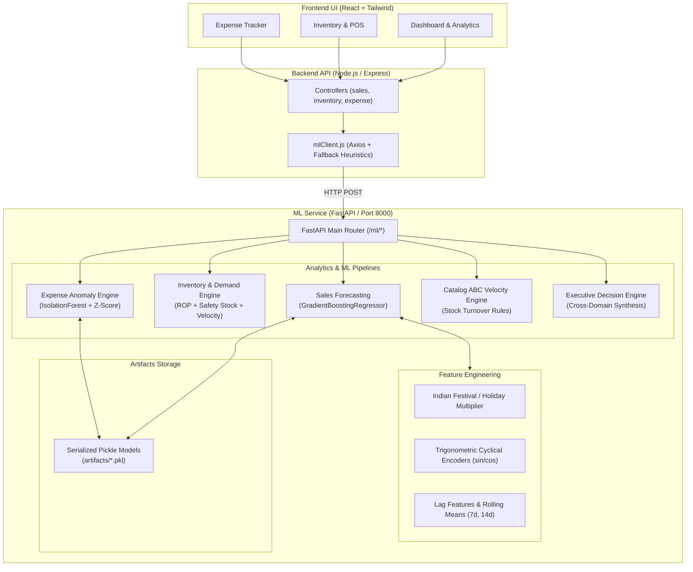

# Smart Merchant AI & Predictive Analytics Engine (`ml-service`)

> **Internal Technical Documentation & Architecture Manual**  
> **Service Port:** `8000` (configurable via `ML_PORT` / `PORT`)  
> **Tech Stack:** Python 3.10+, FastAPI, Scikit-Learn, NumPy, Pandas, Uvicorn, Pydantic v2

---

## 1. Overview & Purpose

The `ml-service` is an autonomous machine learning and statistical decision engine designed for the **Smart Merchant / DWDM Retail ERP Platform**. It powers predictive intelligence across retail operations, replacing guesswork with data-driven decision support for store owners.

### Key Functional Capabilities
1. **Sales & Revenue Forecasting**: Predicts future store turnover with confidence bands using Gradient Boosting with calendar/festival seasonality.
2. **Demand Estimation & Inventory Optimization**: Computes product velocity, safety stocks, reorder points (ROP), and automated purchase order quantities.
3. **Expense Anomaly Detection & Budget Forecasting**: Detects abnormal spending spikes via Isolation Forest algorithms and forecasts monthly category budgets.
4. **Catalog Intelligence & Stock Velocity**: Categorizes products into **High Demand**, **Medium Demand**, **Low Demand**, **Slow Moving**, and **Dead Stock**.
5. **Executive Decision Synthesis**: Aggregates predictions across sales, inventory, and expenses into unified business insights, margin projections, and prioritized action alerts.
6. **Resilient Dual-Tier Architecture**: Functions in tandem with the Node.js backend (`backend/src/services/mlClient.js`), offering real-time ML inference with automated fallback heuristics when offline.

---

## 2. Directory Structure

```
ml-service/
├── app/
│   ├── api/
│   │   └── routes/
│   │       ├── catalog.py          # Catalog classification endpoint (/ml/catalog)
│   │       ├── demand.py           # Demand forecasting endpoint (/ml/demand)
│   │       ├── expense.py          # Expense forecast & anomaly endpoints (/ml/expense)
│   │       ├── insights.py         # Executive summary & decision engine (/ml/insights)
│   │       ├── inventory.py        # Inventory reorder suggestions (/ml/inventory)
│   │       └── sales.py            # Sales forecasting endpoint (/ml/sales)
│   ├── models/
│   │   └── schemas.py              # Pydantic v2 request & response schemas
│   ├── preprocessing/
│   │   └── features.py             # Feature engineering, cyclical encoding, Indian calendar
│   ├── recommendation/
│   │   ├── business_rules.py       # Decision synthesis & cross-domain executive alerts
│   │   ├── expense_rules.py        # Category expense weighted moving averages
│   │   └── inventory_rules.py      # Safety stock, ROP, EOQ, & catalog classification
│   ├── training/
│   │   └── trainer.py              # ML Pipeline singleton, model training, inference, serialization
│   ├── config.py                   # Paths, directories, and server configuration
│   └── main.py                     # FastAPI application setup, CORS, lifespan, router mounting
├── artifacts/                      # Serialized model binaries (.pkl files)
│   ├── sales_model.pkl             # Trained GradientBoostingRegressor & metadata
│   └── anomaly_model.pkl           # IsolationForest models & category baseline stats
├── data/
│   └── samples/                    # Sample fixtures and training seed data
├── requirements.txt                # Python package dependencies
├── run.py                          # Application entry point script
└── README.md                       # Internal technical documentation
```

---

## 3. Architecture & Data Flow



---

## 4. Machine Learning Models & Algorithms

### 4.1 Sales Forecasting (`GradientBoostingRegressor`)
- **Algorithm**: `sklearn.ensemble.GradientBoostingRegressor` (140 estimators, learning rate 0.07, max depth 4).
- **Features Extracted**:
  - `day_of_week`, `day_of_month`, `month`
  - Weekday indicators: `is_sunday` (peak merchant traffic), `is_saturday`, `is_weekend`, `is_peak_workday` (Tue-Thu)
  - Indian Calendar Multipliers: `is_holiday_festival`, `festival_multiplier` (e.g., Diwali 3.2x, Dhanteras 3.0x, Dussehra 2.8x, Ganesh Chaturthi 2.7x, Month-start grocery restock 1.35x)
  - Cyclical Encoding: $\sin(2\pi \cdot \text{dow}/7)$, $\cos(2\pi \cdot \text{dow}/7)$, $\sin(2\pi \cdot \text{month}/12)$, $\cos(2\pi \cdot \text{month}/12)$
  - Autoregressive Lags & Rolling Statistics: `lag_1`, `lag_7`, `rolling_7_mean`, `rolling_14_mean`
- **Confidence Bounds**: Calculates expanding uncertainty intervals per forecast step: $\pm (7\% + \text{step}\%)$.
- **Dynamic Training**: Automatically retrains or adapts when live store invoice histories ($\ge 14$ days) are provided.

### 4.2 Demand Estimation & Safety Stock Reordering
- **Daily Velocity ($v$)**: $\mu$ of trailing 14-day sales volume.
- **Daily Standard Deviation ($\sigma$)**: Sample standard deviation of daily sales.
- **Safety Stock ($SS$)**:
  $$SS = \max\left(2, \; \lceil Z \times \sigma \times \sqrt{L} \rceil\right)$$
  *(where $Z = 1.65$ for 95% service level, $L$ = supplier lead time in days)*
- **Reorder Point ($ROP$)**:
  $$ROP = \lceil (v \times L) + SS \rceil$$
- **Recommended Order Quantity**:
  $$\text{Order Qty} = \begin{cases} \max(0, \; (v \times \text{forecast\_days} + SS) - \text{Current Stock}) & \text{if } \text{Current Stock} \le ROP \\ 0 & \text{otherwise} \end{cases}$$
- **Stock Urgency States**:
  - `Out of Stock`: Current Stock = 0 (Urgency: High)
  - `Critical Shortage`: Current Stock $< (v \times L)$ (Urgency: High)
  - `Low Stock`: Current Stock $\le ROP$ (Urgency: Medium)
  - `Adequate`: Safe operational buffer (Urgency: Low)
  - `Overstocked`: Current Stock $> 45 \times v$ (Urgency: None)

### 4.3 Expense Anomaly Detection (`IsolationForest`)
- **Algorithm**: Category-specific `sklearn.ensemble.IsolationForest` (contamination=0.10).
- **Statistical Fallback**: Combined with Z-score outlier detection ($|z| > 2.0$).
- **Dynamic Range Bounds**: Yields expected ranges $[\mu - 1.5\sigma, \; \mu + 1.5\sigma]$ formatted in INR ($\text{₹}$).

### 4.4 Catalog ABC / Velocity Classification
Classifies products based on sale velocity, inventory age, days since last sale, and turnover ratio:
- **`DEAD STOCK`**: Last sale $> 60$ days ago and sold $< 3$ units. Recommendation: Clearance discount or bundling.
- **`SLOW MOVING`**: Last sale $> 25$ days ago or monthly sales $< 5$ or turnover $< 0.5$. Recommendation: Promotional push.
- **`HIGH DEMAND`**: Monthly sales $\ge 50$ or turnover $\ge 3.0$. Recommendation: Safety stock buffer + bulk procurement.
- **`MEDIUM DEMAND`**: Monthly sales $\ge 20$. Recommendation: Maintain regular replenishment cycle.
- **`LOW DEMAND`**: Standard demand. Recommendation: Order strictly on-demand.

---

## 5. API Reference & Endpoints

Base URL: `http://localhost:8000/ml`

### 5.1 Sales Prediction
- **Endpoint**: `POST /ml/sales/predict`
- **Request Body**:
```json
{
  "days": 7,
  "history": [
    { "date": "2026-03-01", "amount": 18200.0, "order_count": 14, "quantity": 28 },
    { "date": "2026-03-02", "amount": 12400.0, "order_count": 9, "quantity": 18 }
  ]
}
```
- **Response**:
```json
{
  "forecast_days": 7,
  "total_forecasted_sales": 142850.0,
  "trend_percentage": 8.4,
  "daily_forecasts": [
    {
      "date": "2026-03-03",
      "predicted_sales": 14100.0,
      "lower_bound": 12972.0,
      "upper_bound": 15228.0
    }
  ],
  "confidence": 0.91
}
```

---

### 5.2 Product Demand & Stockout Forecast
- **Endpoint**: `POST /ml/demand/predict`
- **Request Body**:
```json
{
  "forecast_days": 7,
  "items": [
    {
      "product_id": "prod_1",
      "product_name": "Basmati Rice 25kg",
      "category": "Grains",
      "current_stock": 5,
      "unit_price": 2400.0,
      "lead_time_days": 3,
      "historical_sales": [4, 5, 3, 6, 4, 5, 7]
    }
  ]
}
```
- **Response**:
```json
{
  "results": [
    {
      "product_id": "prod_1",
      "product_name": "Basmati Rice 25kg",
      "category": "Grains",
      "current_stock": 5,
      "predicted_demand_units": 35,
      "projected_shortage": 30,
      "status": "Critical Shortage",
      "recommended_order_quantity": 38,
      "reorder_urgency": "High",
      "confidence": 0.91
    }
  ],
  "total_shortage_items": 1
}
```

---

### 5.3 Expense Anomaly Detection
- **Endpoint**: `POST /ml/expense/anomalies`
- **Request Body**:
```json
{
  "expenses": [
    { "id": "exp_1", "date": "2026-03-01", "category": "Electricity", "amount": 14500.0 },
    { "id": "exp_2", "date": "2026-03-02", "category": "Rent", "amount": 25000.0 }
  ]
}
```
- **Response**:
```json
{
  "anomalies": [
    {
      "id": "exp_1",
      "date": "2026-03-01",
      "category": "Electricity",
      "amount": 14500.0,
      "expected_range": "₹3,200 - ₹5,800",
      "anomaly_score": 0.88,
      "is_anomaly": true,
      "reason": "Unusually high expense (+222.2% above avg of ₹4,500). Possible unexpected bill or surge."
    }
  ],
  "total_anomalies_detected": 1
}
```

---

### 5.4 Catalog Classification
- **Endpoint**: `POST /ml/catalog/classify`
- **Request Body**:
```json
{
  "products": [
    {
      "product_id": "p101",
      "product_name": "Winter Wool Shawl",
      "category": "Apparel",
      "days_in_inventory": 90,
      "total_units_sold": 1,
      "revenue_generated": 1200.0,
      "last_sale_days_ago": 65,
      "stock_turnover_ratio": 0.2
    }
  ]
}
```
- **Response**:
```json
{
  "classifications": [
    {
      "product_id": "p101",
      "product_name": "Winter Wool Shawl",
      "classification": "DEAD STOCK",
      "recommendation": "Liquidate with deep clearance discount or bundle with fast movers.",
      "action_priority": "High"
    }
  ],
  "summary": {
    "DEAD STOCK": 1
  }
}
```

---

### 5.5 Executive Merchant Summary & Insights
- **Endpoint**: `POST /ml/insights/summary`
- **Request Body**: (Optional, synthesizes overall store records)
```json
{
  "forecast_days": 7,
  "sales_history": [...],
  "products": [...],
  "expenses": [...]
}
```
- **Response**:
```json
{
  "sales_growth_predicted_pct": 12.4,
  "expected_revenue_next_period": 148500.0,
  "expected_gross_profit": 38610.0,
  "expected_cogs": 109890.0,
  "expected_expense_next_period": 8166.67,
  "predicted_net_profit": 30443.33,
  "profit_margin_pct": 20.5,
  "critical_alerts": [
    {
      "type": "INVENTORY",
      "severity": "critical",
      "title": "Stockout Risk: 2 Products",
      "message": "Imminent stock exhaustion for Basmati Rice, Sunflower Oil.",
      "suggested_action": "Issue purchase orders immediately for 45 total units.",
      "impact_metric": "2 at Risk"
    }
  ],
  "top_recommended_actions": [
    "Place expedited purchase orders for Basmati Rice to prevent missed sales.",
    "Capitalize on predicted 12.4% sales growth by setting up bundle promotions."
  ]
}
```

---

## 6. Setup, Installation & Execution

### Prerequisites
- Python 3.10, 3.11, or 3.12
- Virtual environment tool (`venv`)

### Installation Steps

1. **Navigate to the `ml-service` directory:**
   ```bash
   cd "d:\projects and their versions\DWDMLab\ml-service"
   ```

2. **Create and activate a virtual environment (optional but recommended):**
   ```bash
   python -m venv venv
   # On Windows PowerShell:
   .\venv\Scripts\Activate.ps1
   # On Windows Command Prompt:
   .\venv\Scripts\activate.bat
   ```

3. **Install dependencies:**
   ```bash
   pip install -r requirements.txt
   ```

4. **Run the ML Service:**
   ```bash
   python run.py
   ```
   *Alternatively, run directly via Uvicorn:*
   ```bash
   uvicorn app.main:app --host 0.0.0.0 --port 8000 --reload
   ```

5. **Verify health check:**
   - Open browser or curl: `http://localhost:8000/health`
   - Interactive Swagger API Documentation: `http://localhost:8000/docs`
   - Redoc Documentation: `http://localhost:8000/redoc`

---

## 7. Environment Variables

| Variable | Type | Default | Description |
| :--- | :--- | :--- | :--- |
| `ML_PORT` | `int` | `8000` | Port for the FastAPI server |
| `ML_HOST` | `str` | `0.0.0.0` | Host interface binding |
| `PORT` | `int` | `8000` | Fallback port checked by `run.py` |

---

## 8. Development & Maintenance Guidelines

1. **Type Annotations**: Always use standard Python `typing` imports (`List`, `Dict`, `Tuple`, `Optional`, `Any`) or Python 3.10+ native types for schema validation and linter compliance.
2. **Pydantic Validation**: All request/response payloads must adhere to schemas defined in `app/models/schemas.py`. Use `.model_dump()` instead of deprecated `.dict()`.
3. **Artifact Persistence**: Models are serialized as binary `.pkl` files in the `artifacts/` folder. If model architectures or feature vectors change, deleting files in `artifacts/` will trigger automatic retraining on service start.
4. **Backend Resiliency**: If modifying route signatures or return structures, update `backend/src/services/mlClient.js` to ensure the Node.js fallback methods remain compatible with the frontend expectations.
